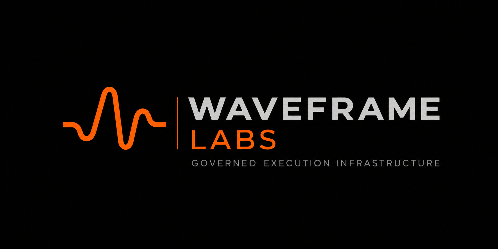

<p align="center">
  
</p>

# Waveframe Labs

Deterministic execution governance for AI and automated systems — deciding whether a proposed action is *allowed* to execute before it reaches production.

> Evaluation is not authorization.

Most governance systems monitor behavior, generate warnings, or audit after execution. Waveframe focuses on something else:

> deterministic admissibility at the execution boundary

## What this is

A hobby project, built in the open, direction play-it-by-ear. The thesis: an AI can propose anything, but the proposal either commits or it doesn't — decided against a compiled authority contract, before it runs. No pilot, no customer, no promises beyond the code that's actually published.

## What's live now

- **Waveframe Ledger 0.9.1** — governance source text turned into deterministic, reviewable authority. Published to PyPI, November 2026.
- **Waveframe Guard 0.19.1** — the runtime enforcement SDK. Wraps execution, evaluates admissibility, blocks invalid actions locally — and keeps enforcing during Cloud outages. Published to PyPI, November 2026.
- **Policy translation** — the current work: turning governance policy into compiled contracts that Ledger and Guard enforce.

The hosted Cloud pilot is retired. Cloud survives in the repos as the registry/audit design, not as a running service.

## How it fits together

```text
Governance Source
        ↓
Governance-Ledger
        ↓
Contract Compiler
        ↓
Compiled Authority Contract
        ↓
Proposal Normalizer
        ↓
Canonical Proposal
        ↓
CRI-CORE
        ↓
COMMIT ALLOWED / BLOCKED
        ↓
Waveframe Guard
        ↓
Production System
```

CRI-CORE is the deterministic enforcement kernel: it evaluates compiled contracts, canonical proposals, and runtime context, and returns `commit_allowed = True | False`. If `False`, the action must not execute.

## Start here

```bash
pip install waveframe-guard
```

## Public repositories

- **Waveframe Ledger** — governance compilation + publication infrastructure
- **Waveframe Guard** — runtime execution enforcement SDK
- **CRI-CORE** — deterministic enforcement kernel
- **CRI-CORE Contract Compiler** — compiles governance policy into contracts
- **Proposal Normalizer** — canonical proposal assembly
- **Waveframe Stamp** — artifact and metadata validation
- **Waveframe publications** — the published papers and write-ups

Coordination lives in **Waveframe-Operations** — "the Stream": the inventory, decisions, and operations log for the project.

## Licensing

| Category | License |
| -------------------- | --------------- |
| Tooling & Code | Apache 2.0 |
| Documentation | CC BY-NC-SA 4.0 |
| Governance & Methods | CC BY 4.0 |

## Links

Website — [https://waveframelabs.org](https://waveframelabs.org)
Publications — Waveframe work on Zenodo, as Shawn C. Wright / Waveframe Labs
ORCID — [https://orcid.org/0009-0006-6043-9295](https://orcid.org/0009-0006-6043-9295)
Contact — [swright@waveframelabs.org](mailto:swright@waveframelabs.org)

---

<div align="center">
  <sub>© 2026 Waveframe Labs</sub>
</div>
